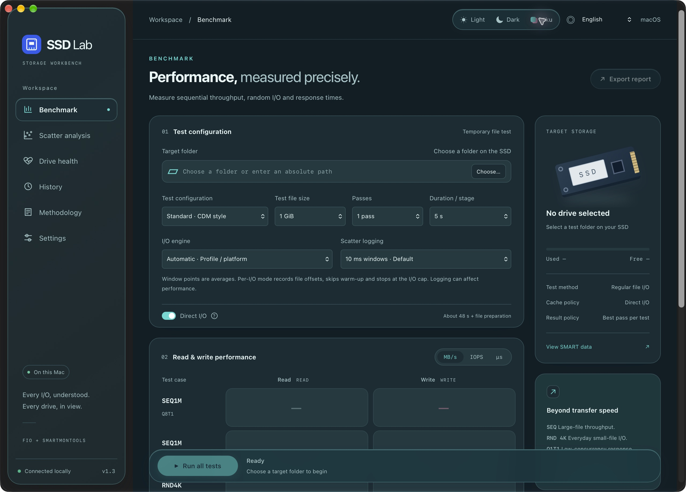

# SSD Lab

A local SSD performance and health workbench for macOS, powered by **fio** and **smartmontools**. Includes CrystalDiskMark-style workloads, genuine fio scatter plots and read-only SMART inspection.

[中文说明](README.zh-CN.md) · [Download for Apple Silicon](https://github.com/HachiMiku39/SSD-Lab/releases)



## What's new in 1.3

- **Light, Dark and Miku themes**, with teal and pink accents in Miku.
- Native **Liquid Glass on macOS 26/27**, with a material fallback on older systems. Navigation and controls use glass; tables and chart surfaces remain clear.
- **Eight interface languages**: English, Simplified Chinese, Traditional Chinese, Japanese, Korean, German, French and Spanish. First launch defaults to English and Light. The native app preserves appearance and language across restarts.
- Localized controls, SMART labels, axis labels, status messages and native menus. Changing appearance or language does not start a benchmark or modify measured data.
- Supports reduced motion, reduced transparency and increased contrast.

## Benchmark and analysis

- Standard / NVMe workloads inspired by CrystalDiskMark, a POSIX synchronous Q1 profile, and 4 KiB R70/W30 QD1/4/16/32 sweeps.
- Engines: `posixaio`, `psync`, `sync` and platform-dependent automatic selection. Synchronous engines reject unsupported queue depths.
- Uses temporary files in a selected folder, never raw-device writes. Preparation also writes data for read tests. Completed or cancelled tests clean up their temporary files.
- Per-pass statistics, bandwidth median / CV and host-side total latency percentiles up to P99.999. Percentiles from different jobs are not averaged.
- Scatter plots with configurable X/Y fields, linear/log scales, ranges, test filters, read/write filters and PNG/CSV export. File offsets are **not physical LBAs**.
- Default latency points are 10 ms window means. Optional per-I/O logging records offsets, skips warm-up and caps each stage at 200,000 I/Os. Logging can change measured performance.
- Large logs are sampled, retaining the slowest points. Point proportions do not represent the original distribution. Percentiles always come from full fio statistics.
- Read-only SMART health, temperature, device identity and NVMe / ATA attributes. Optional macOS system authorization for SMART. Support varies with device permissions and USB bridges.
- Local history, JSON reports with original fio output and exact commands, and CSV summaries. No analytics or cloud reporting.

## Run on macOS

Download and extract `SSD-Lab-macOS-arm64.zip` from Releases, then open **SSD Lab.app**. The Apple Silicon bundle includes CPython, fio 3.43 and smartmontools 7.5. It requires **macOS 13 or newer**.

The current bundle is locally signed (ad hoc), without Apple Developer ID signing or notarization. It was validated on the development Mac; distribution to other Macs needs normal macOS approval and may require additional validation.

## Run from source

The backend uses only Python's standard library (Python 3.10+). Install real fio and smartmontools, then:

```sh
brew install fio smartmontools
python3 -B app.py
python3 -B -m unittest discover -s tests -v
```

The process listens on loopback only and uses a per-session token. Tool paths can be configured in the UI. Windows and Linux can run the local browser interface, but their binaries and hardware behavior have not been validated in this release.

To rebuild the native Apple Silicon shell, use Xcode 27 command line tools / SDK (the new material API needs a recent SDK):

```sh
# Optional: rebuild pinned upstream tools. Requires Python 3.12+.
python3 scripts/bootstrap_tools.py

# Uses a system Python unless a relocatable runtime is supplied.
python3 build_macos.py
python3 build_macos.py --python-runtime /absolute/path/to/relocatable/python
```

The app and ZIP are written beside the source folder. Runtime data is stored in `~/Library/Application Support/SSD Lab/`; it is not part of this repository.

## Measurement scope and research

These are **file-level host measurements**, including the filesystem, I/O stack and SSD. This app does not erase drives, perform full-device preconditioning, verify device steady state, measure power, or claim SNIA / OCP compliance. Short write peaks do not establish cache-exhausted sustained write speed. SMART life estimates do not predict failures.

The in-app Methodology page documents primary sources, including:

- [Samsung PM863 white paper](https://semiconductor.samsung.com/resources/white-paper/PM863_White_Paper.pdf): fio, mixed workloads, queue sweeps and P99.99 latency.
- [Samsung 990 PRO datasheet](https://download.semiconductor.samsung.com/resources/data-sheet/Samsung_NVMe_SSD_990_PRO_Datasheet_Rev.1.0_10119997004809.pdf): defined host conditions and Intelligent TurboWrite.
- [SNIA SSS PTS 2.0.2](https://www.snia.org/sites/default/files/2025-02/SNIA-SSS-PTS-2.0.2.pdf) and [OCP Datacenter NVMe SSD 2.7](https://www.opencompute.org/documents/datacenter-nvme-ssd-specification-v2-7-final-pdf-1/).
- [Practical Erase Suspension for Modern Low-latency SSDs](https://www.usenix.org/conference/atc19/presentation/kim-shine), USENIX ATC 2019, including Samsung authors.
- [A New LSM-style Garbage Collection Scheme for ZNS SSDs](https://www.usenix.org/conference/hotstorage20/presentation/choi), HotStorage 2020, including SK hynix authors.

The engineering implications are inferences from public research, not manufacturer certification or endorsement. This project is independent and not affiliated with Crystal Dew World, Samsung or SK hynix.

## Licenses

SSD Lab's own code is under the [MIT License](LICENSE). fio and smartmontools retain their respective upstream GPL licenses; corresponding source archives and license copies are included in the application bundle. This repository keeps the license copies in `third-party/`; `scripts/bootstrap_tools.py` downloads checksum-verified official source archives when needed. Bundled CPython retains the PSF license in its standard library. The source code does not include private benchmark reports, drive serial numbers or local session tokens.
